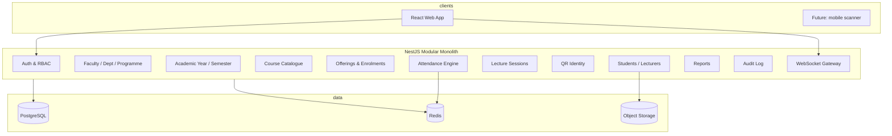
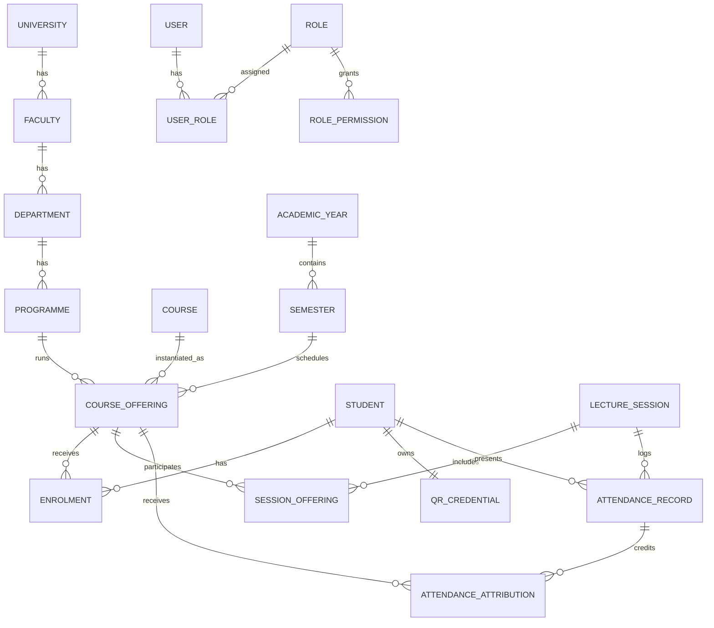

# Attendify — System Architecture & Database Design (Phase 0)

**Status:** Phase 1 in progress — **product is kept simple** (staff/lecturer + student roles in the app; no in-app administrator hierarchy). Full enterprise RBAC below remains a **future** option if institutions need it.  
**Date:** 2026-03-25  
**Current prototype:** Static HTML + Node HTTP server + SQLite (`data/attendify.db`) — proof of roster, per-class enroll links, and single-class QR scan.  
**Target:** Modular monolith — React/TS frontend, NestJS/TS API, PostgreSQL/Prisma, Redis, WebSockets, S3.

---

## 1. Requirements analysis (summary)

| Area | Requirement | Design implication |
|------|-------------|-------------------|
| Identity | One **permanent** QR per student, no course data in QR payload | Opaque token + server-side lookup; store **hash** only |
| Academic org | University → Faculty → Department → Programme → Course → **Offering** → Enrolment | Normalized hierarchy; catalogue ≠ offering |
| Shared lectures | One physical session, **many offerings**, one scanner | `lecture_sessions` ↔ `course_offerings` (M:N via `session_offerings`) |
| Attendance | One event per student per session; **attributions** per eligible offering | `attendance_records` + `attendance_attributions`; `UNIQUE(student_id, session_id)` |
| Access | Scoped RBAC (7 roles) | Permissions in DB + NestJS guards; no UI-only security |
| Real-time | Live scan feed for lecturers | WebSocket rooms per `lecture_session_id` |
| Reports | Multi-dimensional exports (PDF/Excel) | Read models / query layer; export jobs |

Non-goals for Phase 1–2: full notifications, S3 at scale, multi-tenant universities (single university instance first, schema ready for extension).

---

## 2. High-level architecture



**Patterns**

- **Modular monolith:** Each numbered module = NestJS feature module with its own controllers, services, DTOs, and Prisma usage. Shared kernel: `common/` (guards, filters, pagination, tenant scope).
- **CQRS-lite:** Writes through attendance engine; dashboards/reports use optimized queries (materialized views later if needed).
- **Events:** In-process `EventEmitter` first; `attendance.scanned` → WebSocket + audit; Redis pub/sub when scaling horizontally.

**Deployment (target)**

- Docker Compose: `api`, `web`, `postgres`, `redis`, `minio` (S3-compatible).
- HTTPS termination at reverse proxy; secrets via env (never commit).

---

## 3. Entity relationship overview



---

## 4. PostgreSQL schema (logical model)

Naming: `snake_case` tables, `uuid` primary keys, `timestamptz` for audit fields.

### 4.1 Auth & users

```text
users
  id, email (unique), password_hash, status (active|suspended),
  student_id (nullable FK), lecturer_id (nullable FK),
  created_at, updated_at

refresh_tokens
  id, user_id, token_hash, expires_at, revoked_at

roles
  id, code (unique): super_admin | university_admin | faculty_admin |
      department_admin | lecturer | attendance_officer | student

permissions
  id, code (unique), resource, action

role_permissions
  role_id, permission_id

user_roles
  user_id, role_id, scope_type (university|faculty|department|programme|offering|null),
  scope_id (uuid nullable)  -- organizational scope for admin roles
```

### 4.2 Organizational & academic calendar

```text
universities
  id, name, code

faculties
  id, university_id, name, code

departments
  id, faculty_id, name, code

programmes
  id, department_id, name, code, degree_level

academic_years
  id, university_id, label, start_date, end_date, is_current

semesters
  id, academic_year_id, name, sequence, start_date, end_date, total_weeks, is_current
```

### 4.3 Catalogue & offerings

```text
courses
  id, catalogue_code (unique), title, description, credit_hours, department_id (owner)

course_offerings
  id, course_id, programme_id, semester_id,
  level (e.g. 100), cohort_label, section_code,
  status (draft|open|closed|archived),
  UNIQUE(course_id, programme_id, semester_id, section_code)

enrolments
  id, student_id, course_offering_id, status (active|dropped|completed),
  enrolled_at,
  UNIQUE(student_id, course_offering_id)
```

### 4.4 People

```text
students
  id, university_id, index_number (unique), legal_name, email, phone,
  photo_object_key (S3), account_status (active|inactive|graduated),
  user_id (nullable FK)

lecturers
  id, university_id, staff_id, name, email, department_id,
  user_id (nullable FK)

lecturer_assignments
  id, lecturer_id, course_offering_id, role (primary|assistant),
  UNIQUE(lecturer_id, course_offering_id)
```

### 4.5 Lecture sessions (multi-offering)

```text
lecture_sessions
  id, title, semester_id,
  scheduled_start, scheduled_end, venue,
  status (scheduled|open|closed|finalized|cancelled),
  opened_at, closed_at, finalized_at,
  created_by_user_id

session_offerings
  lecture_session_id, course_offering_id,
  PRIMARY KEY (lecture_session_id, course_offering_id)

session_lecturers
  lecture_session_id, lecturer_id, role (lead|scanner|assistant),
  PRIMARY KEY (lecture_session_id, lecturer_id)
```

**Rule:** One physical class = one `lecture_session`. Multiple programmes in the same room = multiple rows in `session_offerings`, not duplicate sessions.

### 4.6 QR identity

```text
qr_credentials
  id, student_id (unique active per student via partial unique index),
  public_token_id (uuid, for QR payload — not secret),
  secret_hash (argon2id or sha256+bcrypt of raw secret),
  status (active|revoked),
  issued_at, revoked_at, revoked_reason

qr_credential_history
  id, student_id, secret_hash, status, rotated_at  -- audit of rotations
```

**QR payload (v1):** `ATTENDIFY:v1:{public_token_id}` — optional signed JWS later. **Never** embed programme, password, or PII.

### 4.7 Attendance

```text
attendance_records
  id, lecture_session_id, student_id,
  status (present|late|excused|pending_verification),
  scanned_at, recorded_by_user_id, scan_method (qr|manual|import),
  UNIQUE(student_id, lecture_session_id)

attendance_attributions
  id, attendance_record_id, course_offering_id,
  attribution_status (credited|ineligible|pending),
  UNIQUE(attendance_record_id, course_offering_id)

attendance_corrections
  id, attendance_record_id, requested_by, reviewed_by,
  previous_status, new_status, reason, status (pending|approved|rejected)
```

**Engine flow (transaction):**

1. Resolve `public_token_id` → `qr_credentials` → `student`.
2. Load `lecture_session` (must be `open`).
3. Load offering IDs from `session_offerings`.
4. Intersect with `enrolments` where `status = active`.
5. If empty → reject (not enrolled in any participating offering).
6. Insert `attendance_records` or handle duplicate → return existing.
7. Insert `attendance_attributions` for each eligible offering (one row per offering).
8. Commit; emit `AttendanceScannedEvent`; push WebSocket.

**Absent records:** Created only when session is **finalized** (batch job or finalize endpoint), not on scan.

### 4.8 Supporting

```text
audit_logs
  id, actor_user_id, action, entity_type, entity_id, metadata jsonb, ip, created_at

notifications (Phase 7)
  id, user_id, channel, payload, read_at

system_settings
  key, value jsonb
```

### 4.9 Indexes (critical)

- `enrolments(student_id, course_offering_id)`
- `session_offerings(lecture_session_id)`, `session_offerings(course_offering_id)`
- `attendance_records(lecture_session_id, scanned_at)`
- `qr_credentials(public_token_id)` where `status = active`
- `students(index_number)`

---

## 5. Permanent QR identity (how it works)

| Step | Behavior |
|------|----------|
| Registration | Generate 32-byte random secret; `public_token_id` = UUID; store `hash(secret)` |
| Display | Frontend requests short-lived **display token** or renders QR from `ATTENDIFY:v1:{public_token_id}`; server validates by lookup |
| Scan | Scanner sends `public_token_id` (+ optional HMAC in v2); server never trusts client-side course logic |
| Revoke | Set `status = revoked`; scans fail with clear error |
| Regenerate | New credential; old revoked; one active credential per student |

Same QR works for **any** session where the student has an active enrolment in a participating offering.

**Migration from prototype:** Replace `ATD|classId|index` with opaque token; map legacy students through one-time credential issuance.

---

## 6. Multi-department lecture sessions

**Example:** Dr. Smith opens “Introduction to Computing” at 09:00.

- Creates **one** `lecture_sessions` row.
- Links offerings: IT CS101, CS CS101, DS CS101 via `session_offerings`.
- Assigns self + co-lecturer in `session_lecturers`.
- Opens session → `status = open`.

Students from any linked offering scan the **same** QR. Attendance engine credits **only** offerings they are enrolled in (1 record, N attributions where N = eligible offerings count).

**Anti-pattern (forbidden):** Creating three `lecture_sessions` for the same room/time because programmes differ.

---

## 7. Attendance attribution

| Concept | Purpose |
|---------|---------|
| `attendance_records` | “Student X was present in session Y at time T” |
| `attendance_attributions` | “That presence counts toward offering A and offering B” |

Reporting for **BSc IT CS101** counts attributions where `course_offering_id` matches and session was eligible (finalized, not excused, etc.).

Percentage = present attributions / eligible session count for that offering (configurable: count shared sessions once per offering).

---

## 8. Roles & permissions (matrix excerpt)

| Permission code | Super | Univ | Faculty | Dept | Lecturer | Attend officer | Student |
|-----------------|-------|------|---------|------|----------|----------------|---------|
| `user.manage` | ✓ | ✓ | | | | | |
| `faculty.manage` | ✓ | ✓ | | | | | |
| `offering.read` (scoped) | ✓ | ✓ | ✓ | ✓ | assigned | dept | own enrolments |
| `session.create` | ✓ | | | ✓ | assigned | | |
| `session.open/scan` | | | | | assigned session | ✓ | |
| `attendance.correct` | ✓ | | | ✓ | own sessions | ✓ | request own |
| `report.export` | ✓ | ✓ | ✓ | ✓ | own offerings | dept | own |
| `qr.revoke` | ✓ | | | ✓ | | | own view |

Enforcement: NestJS `@RequirePermissions()` + scope resolver (department_id from JWT claims or DB lookup).

**Student:** JWT linked to `students.user_id`; can only `GET /me/attendance`, `GET /me/qr/display`.

---

## 9. Frontend application map (React)

| Route area | Roles |
|------------|-------|
| `/admin/university` | Super, Univ admin |
| `/admin/faculty/:id` | Faculty admin |
| `/admin/department/:id` | Dept admin |
| `/lecturer/dashboard` | Lecturer |
| `/lecturer/scanner/:sessionId` | Lecturer (authorized session) |
| `/student/home` | Student — QR, courses, % |
| `/reports/*` | Scoped by permission |

Shared: shadcn/ui layout, TanStack Query for API, optimistic UI only where safe (not attendance writes).

---

## 10. Implementation roadmap

### Phase 1 — Foundation (after approval)

- Monorepo: `apps/web`, `apps/api`, `packages/shared-types`
- Docker Compose: Postgres, Redis
- Prisma schema from §4; initial migration
- Auth: register/login, refresh tokens, Argon2id
- RBAC: roles, permissions, guards
- Audit log middleware

**Exit criteria:** Login as admin; CRUD smoke test; migration reproducible.

### Phase 2 — Academic structure & people

- Faculties, departments, programmes, years, semesters
- Students, lecturers, users linkage
- Admin UIs (minimal)

### Phase 3 — Offerings & enrolments

- Course catalogue, offerings, enrolments, lecturer assignments
- Replace prototype “classes” with offerings

### Phase 4 — QR & sessions

- QR credential lifecycle API
- Lecture session CRUD + `session_offerings` M:N
- Student QR display/download

### Phase 5 — Attendance engine

- Scan endpoint + transactions + attributions
- Session open/close/finalize
- Corrections workflow (basic)

### Phase 6 — Real-time

- WebSocket gateway, lecturer live board
- Migrate scanner UI from prototype

### Phase 7 — Reports & notifications

- PDF/Excel exports, dashboards per role
- Email/in-app notifications (optional)

### Phase 8 — Hardening

- Load tests on scan path, security review, backups, CI/CD

**Prototype coexistence:** Run `legacy/` folder until Phase 5; one-time data migration script from SQLite → Postgres (students, offerings mapping).

---

## 11. Architectural risks & mitigations

| Risk | Impact | Mitigation |
|------|--------|------------|
| Duplicate scans under concurrency | Wrong counts | `UNIQUE(student_id, session_id)` + serializable/row lock in transaction |
| QR token leakage | Impersonation | Hash-only storage; rate limit scan API; short lockout on abuse |
| Shared session complexity | Wrong attributions | Integration tests per multi-offering scenario; explicit ineligible attributions |
| Scope bypass in RBAC | Data leak | Central `PolicyService`; integration tests per role |
| Report query cost | Slow exports | Indexes; async export jobs; summarize by semester |
| Big-bang rewrite | Delivery slip | Phased modules; keep legacy until parity |
| Single-university assumption | Future multi-tenant | `university_id` on major tables from day one |

---

## 12. API conventions (preview)

- REST: `/api/v1/...`
- Versioned OpenAPI (Swagger) per module
- Idempotency-Key header on `POST /attendance/scan`
- Standard error shape: `{ code, message, details }`

---

## 13. Approval checklist

Before Phase 1 code:

- [ ] Confirm single-university scope for v1
- [ ] Confirm QR payload format `ATTENDIFY:v1:{public_token_id}`
- [ ] Confirm shared session model (`session_offerings`)
- [ ] Confirm attendance statuses enum
- [ ] Confirm offering uniqueness key (`section_code` per programme/semester)
- [ ] Decide monorepo tool (pnpm workspaces + Turborepo recommended)
- [ ] Approve migration strategy from current SQLite prototype

---

## 14. Relation to current prototype

| Prototype | Target mapping |
|-----------|----------------|
| `classes` | `course_offerings` (simplified; add programme/semester) |
| `students` + per-class enroll link | `enrolments` + single QR credential |
| `sessions` key `classId:date` | `lecture_sessions` + `attendance_records` |
| Static HTML dashboards | React role dashboards |
| SQLite `db.js` | Prisma repositories |

---

**Next step on approval:** Scaffold `apps/api` (NestJS) + Prisma schema file matching §4, implement Phase 1 auth/RBAC only.
