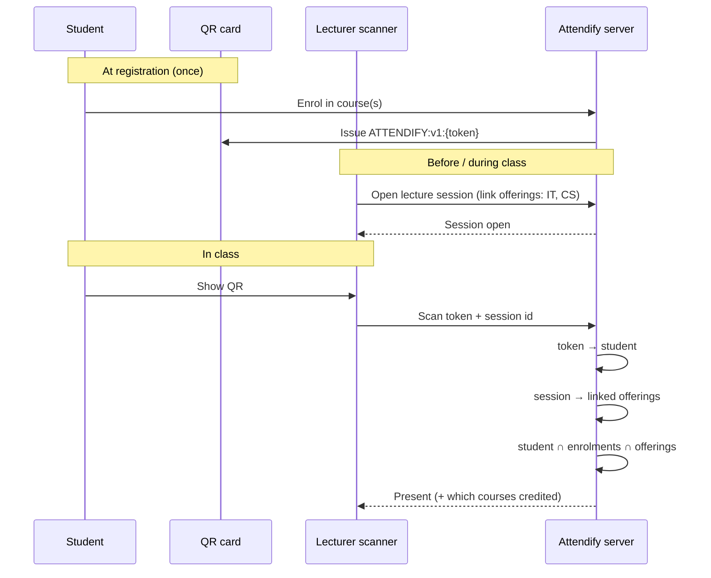
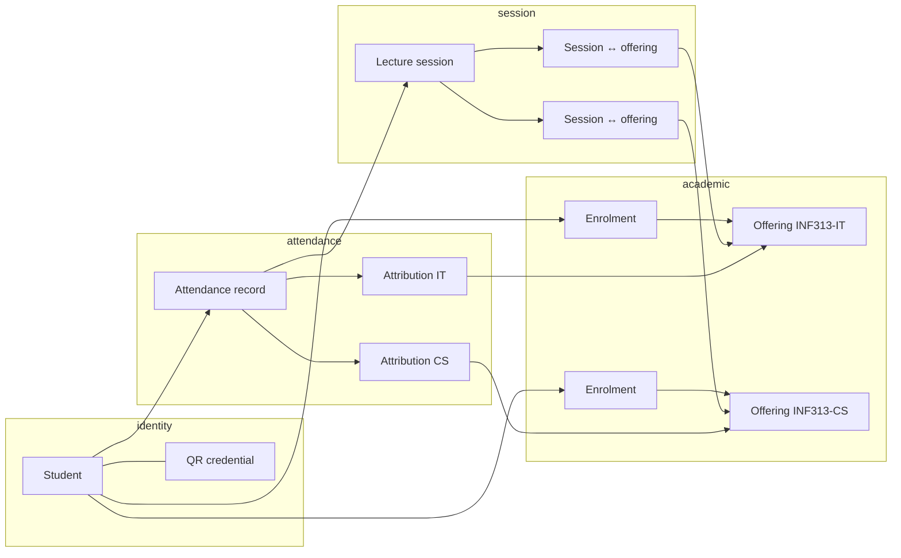

# Attendance flow — one QR, many courses, shared lectures

This is how Attendify should behave in real use (prototype + future API share the same rules).

---

## Core ideas (plain language)

| Idea | What it means |
|------|----------------|
| **One QR per department** | Same **department**, any number of courses → **one QR** (same index in that dept). IT and CS use **different index numbers** → **different QRs** (that is normal). |
| **QR is not “per course”** | Enrolling in CS 101 and CS 210 (both Computer Science) does **not** print a second card. |
| **Course / class** | A **course offering** you run this semester (e.g. CS INF313 — Web Tech II). |
| **Lecture session** | **One real meeting** — one room, one time, one scan screen (e.g. Tuesday 10:00). |
| **Shared lecture** | The **same session** counts for **more than one offering** (e.g. IT + Computer Science). |
| **Department** | A label on an offering (IT, CS). Shared lectures attach **multiple offerings**, not “one QR per department”. |

**Wrong model:** new QR per course in the same department, or a second scan because IT and CS sat together.  
**Right model:** one QR per **(department + index number)**; scan **once** in a shared lecture → credit only the courses they joined in that room.

### Index numbers differ by department (expected)

| Student | Department | Index | QR |
|---------|------------|-------|-----|
| Ama | Computer Science | `CS2024-0041` | QR-A |
| Ben | Information Technology | `IT2024-0199` | QR-B |

Same lecture hall, one scanner: Ama shows QR-A, Ben shows QR-B — **different index format, different QR**, **one scan each**.

---

## Example: Web Tech II for IT and CS

**Catalogue:** one module “INF313 Web Technologies II”.  
**Two offerings this semester:**

- **INF313-IT** — Information Technology programme  
- **INF313-CS** — Computer Science programme  

**Tuesday 10:00 — Lecture Hall B** (one physical class):

- Lecturer opens **one** scanner for **Lecture session #42**.
- Session #42 is linked to **both** offerings (IT + CS).
- Student **Ama** (CS programme) and **Ben** (IT programme) both use the **same kind** of QR card (their own permanent code).

**Scan Ama’s QR once:**

1. Server finds Ama’s student profile from the QR token (no course data in the QR).
2. Server loads session #42 and its linked offerings: `[INF313-IT, INF313-CS]`.
3. Server checks Ama’s **active enrolments** → only `INF313-CS`.
4. One **attendance event** for session #42; **credit** only for `INF313-CS` (not IT — not enrolled).

**Scan Ben’s QR:** same session → credit for `INF313-IT`.

**If Ama were enrolled in both programmes** (rare): one scan → **two attributions**, one per offering.

---

## End-to-end flow

---

## Data model (conceptual)

**Rules:**

- `UNIQUE(student, lecture_session)` — one physical presence per session.
- **Attributions** — zero or more rows per offering they’re allowed to get credit for.
- QR payload: `ATTENDIFY:v1:{public_token_id}` only — **no** programme, department, or class id.

---

## Who does what (simple roles)

| Actor | Action |
|-------|--------|
| **Student** | Enrol via link; download **one** QR card; show it at every lecture. |
| **Lecturer** | Create/open today’s **lecture session**; attach **all offerings** in the room; scan QRs. |
| **Reports** | Attendance per offering = attributions; shared lecture does **not** double-count people in the room. |

---

## Prototype (localhost:3000) mapping

| Full model | Prototype table / field |
|------------|-------------------------|
| Student + QR | `students.qr_public_id` → `ATTENDIFY:v1:…` |
| Offering | `classes` (+ optional `department`) |
| Enrolment | `students.class_id` (one row per offering; same `qr_public_id` if same index) |
| Lecture session | `attendance_sessions` + `attendance_session_classes` |
| Scan | `POST /api/attendance` with `qrToken` |
| Share IT + CS | `POST /api/sessions/share` with today’s `classId` + extra class ids |

Legacy format `ATD|classId|index` still works briefly; new cards use the v1 token.

---

## PostgreSQL / Nest (future)

Implemented in `apps/api/prisma/schema.prisma`: `lecture_sessions`, `session_offerings`, `qr_credentials`, `attendance_records`, `attendance_attributions`. See [ARCHITECTURE.md](ARCHITECTURE.md) §4.5–4.7.

---

## FAQ

**Same module, different departments — one or two courses?**  
Two **offerings** (IT vs CS), one **catalogue** course. Shared lectures link **both offerings** to **one session**.

**Student pursues 6 courses — how many QRs?**  
**One.**

**Lecturer teaches CS 101 three times a week?**  
Three **lecture sessions**; same students scan the **same QR** each time.

**Student scans but isn’t on that course?**  
Reject or “present but not credited” — no attribution rows for offerings they’re not enrolled in.
